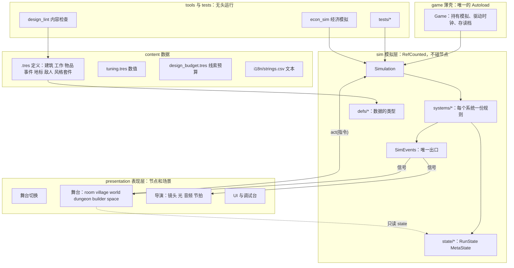
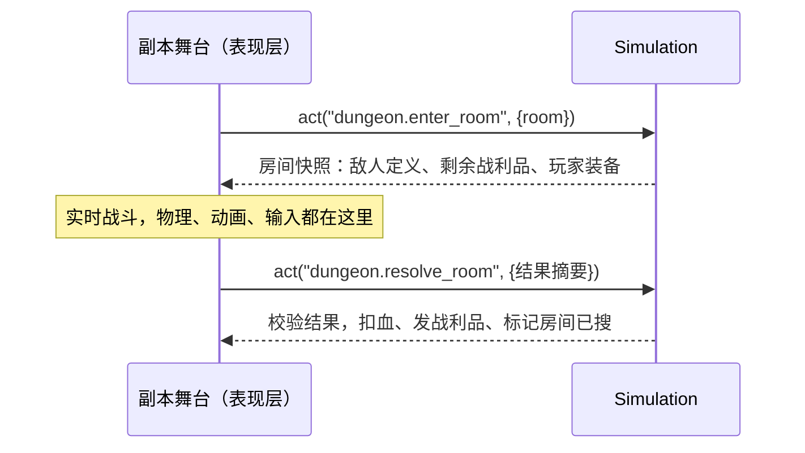

# 架构

本文档描述《A Dark Room》Godot 重制版（`remake`）的整体架构：分几层、每层管什么、层与层之间怎么通信、新系统往哪里放。它服务于路线图（ADR Godot 重制路线图）的阶段 3 到阶段 9，第一章已有的代码就是按这里的结构写的。

配套文档：

- `docs/dev_guide.md`：开发规范，规定 AI 和人怎么按这套架构干活。
- 分项规范：`docs/gameplay.md`（玩法）、`docs/narrative.md`（剧情）、`docs/art.md`（美术）、`docs/modeling.md`（建模）、`docs/audio.md`（音乐与音效）。

文档里标注的状态：**已有**表示代码里已经实现；**待建**表示架构已经定了、代码还没写；**待定**表示需要制作人拍板。

---

## 1. 约束与目标

这些约束来自路线图和此前的讨论，架构上的每个取舍都可以追溯到其中一条。

| 约束 | 对架构的要求 |
| --- | --- |
| 开源，Steam 免费发布，只做 PC | 保留 Forward+ 渲染器；不为 Web 和手机做兼容 |
| 主要由 AI 开发 | 每条规则都能被机器检查；一条命令能验证全部改动；结构扁平、命名可预测 |
| 村庄加速、玩家亲手操作保持原速 | 模拟按时间域分开推进，和帧率、真实时间无关 |
| 二周目带走"理解"而不是"加成" | 跨周目状态在接口上就存不了数值 |
| 线索预算、不能有虚假的选择、不能有可刷的奖励点 | 内容全部数据化，设计原则写成检查规则 |
| 2D 与 3D 混合（3D 暗室、2D 建造者、3D 大地图与副本） | 规则只写一份，画面可以换 |
| 长期维护：剧情重写、四套风格、多语言 | 内容、文本、素材都通过 id 引用，可以被脚本扫描 |
| 尽可能不用文字 | 模拟层发的是叙事节拍，不是句子；表现层负责用光、声音、动作把节拍演出来 |

一句话概括：**模拟层是唯一的规则来源，表现层只负责把它演出来；内容是数据，设计原则是代码。**

---

## 2. 分层



### 2.1 依赖方向（红线）

只允许箭头方向的依赖，反过来就是架构错误：

```
presentation  ──>  game  ──>  sim  ──>  sim/defs  <──  content
     │                         ▲
     └────── 只读 state，写只能走 act() ──┘
tools, tests  ──>  sim（不依赖 presentation 和 game）
```

- `sim/` 不引用任何 `Node`、`Input`、`Time`、`OS`、`get_tree()`、全局 `randi()`/`randf()`、`await`，也不引用 `presentation/` 和 `game/` 里的任何东西。
- `presentation/` 不修改 `sim.state` 的任何字段。读可以，写只能通过 `Game.sim.act(指令, 参数)`。
- `tools/` 和 `tests/` 依赖 `sim/` 和 `content/`，不依赖 `Game`，不实例化舞台场景，这样它们可以在 `--headless` 下运行。表现层里不依赖节点树的纯函数类（例如 `OpeningView`）可以被测试直接调用。
- `content/` 里的 `.tres` 只引用 `sim/defs/` 里的脚本，不引用系统脚本和表现层脚本。

### 2.2 目录

```
remake/
  project.godot
  game/                  Autoload：Game                                  已有
  sim/                   模拟层                                          已有
    simulation.gd        入口：状态、时钟、指令表、系统列表
    sim_clock.gd         固定步长时钟和时间域
    sim_events.gd        对外的全部信号
    sim_system.gd        系统基类
    content_db.gd        读 content，按 id 建索引，校验引用
    save_store.gd        存档读写和版本迁移
    tuning.gd            数值的类型
    defs/                数据定义（Resource 子类）
    state/               RunState、MetaState，以及各系统的状态分区
    systems/             每个系统一个文件
    gen/                 程序生成：地图、副本房间图                       待建
  content/               全部内容数据，文件名就是 id                      已有
    buildings/ jobs/ items/ events/ landmarks/ enemies/ style_kits/
  i18n/                  strings.csv，第一列是键                          已有
  presentation/          表现层                                          已有
    main.tscn            真正的入口场景：舞台切换 + UI 层 + 统一后处理    待建
    stages/              每个地点一个舞台                                待建（room 暂在 presentation/room）
    directors/           镜头、光照、音频、节拍导演                       待建
    ui/                  Theme、日志、按钮、面板                          部分已有（建造者的数据板）
    common/              共享的着色器、环境、材质、NPC 头顶字幕            部分已有（NpcSpeech）
    audio/               代码合成的声音：占位音效、NPC 说话声（Babble）     已有
    debug/               调试台                                          已有
  assets/                从 Art 导出的运行时素材（glb、贴图、音频）         已有
  tests/                 测试，test_*.gd                                 已有
  tools/                 无头工具：测试运行器、设计检查、经济模拟          已有
  lore/                  世界观设定库                                    待定
  docs/                  文档
```

工作区根目录下的 `Art/` 放源文件（`.blend`、概念图、导出脚本），不进 `remake` 的仓库；`adarkroom_old/` 是原版源码，只读参考。

---

## 3. 模拟层

### 3.1 Simulation：唯一的入口（已有）

`Simulation` 持有一局游戏的全部东西，对外只有四类接口：

| 接口 | 谁用 | 说明 |
| --- | --- | --- |
| `new_run(seed)` / `load_run(state)` / `capture()` | `Game`、测试 | 开新局、读档、取出可存档的状态 |
| `advance(real_delta)` / `step()` / `run_for(seconds)` | `Game`、测试、工具 | 推进时间。只有 `advance` 和真实时间有关 |
| `act(command, args) -> StringName` | 表现层、测试、经济模拟 | 玩家做了一件事。成功返回 `Simulation.OK`（空 StringName），失败返回原因键 |
| `events` | 表现层、工具 | 状态变化的通知，见 3.6 |

另外提供给系统用的辅助方法：库存（`store`/`add_store`/`can_afford`/`pay`）、解锁（`has_feature`/`unlock`）、叙述（`narrate`）、计时器（`start_timer`/`tick_timer`/`tick_repeating`）、冷却（`start_cooldown`/`cooldown_left`）。系统之间不直接调用对方，都通过这些辅助方法和状态打交道。

系统列表写在 `Simulation._init` 里，**顺序就是每一步的执行顺序**，改顺序等于改规则，要有测试覆盖。

### 3.2 系统：只有规则，没有状态（已有）

```gdscript
class_name XxxSystem
extends SimSystem

const CMD_DO := &"xxx.do"             # 指令名：<系统>.<动词>
const FEATURE := &"xxx"               # 解锁名
const TIMER_TICK := &"xxx.tick"       # 计时器名：<系统>.<用途>

func domain() -> SimClock.Domain: ...  # 属于哪个时间域
func register(sim: Simulation) -> void: sim.register_command(CMD_DO, _do)
func step(sim: Simulation, dt: float) -> void: ...
func _do(sim: Simulation, args: Dictionary) -> StringName: ...
```

- 系统不持有 `Simulation` 的引用，也没有成员变量（常量除外）。需要记住的东西一律放进状态。这样存档只需要序列化状态。
- 一个系统负责一块规则。当前有 `FireSystem`、`BuilderSystem`、`ForestSystem`、`VillageSystem`。
- 指令处理函数先检查所有前置条件，任何一条不满足就返回原因、不改任何状态；全部满足之后再扣费、改状态、发事件。不允许"改了一半失败"。
- 表现层要提前知道"现在点了能不能成"（决定亮不亮、数据板上哪项是暗的）时，系统提供只读的静态查询函数，例如 `FireSystem.can_tend`、`ForestSystem.can_gather`、`VillageSystem.can_build`。指令处理函数复用同一个查询，保证两边答案一致；表现层不自己重写规则。

### 3.3 时间（已有）

`SimClock` 用固定步长 `STEP = 0.05` 秒推进，和帧率无关。同一个种子加同一串指令，结果一定相同。

时间分域，每个系统通过 `domain()` 声明自己属于哪一个：

| 时间域 | 速度 | 管什么 |
| --- | --- | --- |
| `HAND` | 永远原速 | 玩家亲手做的事：火、室温、手动操作的冷却 |
| `VILLAGE` | `Tuning.village_speed` 倍 | 村庄自己运转的事：村民产出、人口、小偷 |
| `WORLD` | 待建 | 大地图上的补给消耗按"走了几格"结算，不按时间（沿用原版） |

`clock.time_scale` 是开发用的整体倍率，不是给玩家的倍速功能。关掉游戏时间就冻结，不做离线收益。

### 3.4 随机（已有，生成部分待建）

- 模拟里所有的随机都从 `sim.rng` 取，它的状态跟着存档走。禁止用全局 `randi()`、`randf()`、`Array.shuffle()`、`Array.pick_random()`。
- 程序生成（地图、副本）不消耗主随机流：用 `hash([run_seed, 用途, 对象 id])` 派生一个独立的 `RandomNumberGenerator`。这样加一个新的生成器不会改变已有的事件结果。
- **生成的结果一旦生成就写进 RunState**，以后读档直接用存下来的结果，不靠重新生成复原。生成器代码会改，存档不能跟着变。

### 3.5 状态（已有，分区待建）

| 状态 | 生命周期 | 内容 | 约束 |
| --- | --- | --- | --- |
| `RunState` | 一局 | 种子、随机数状态、时间、库存、建筑、人口、解锁、计时器、冷却，以及各系统的状态 | 必须能完整序列化成 JSON 并原样读回 |
| `MetaState` | 跨周目 | 见过什么、知道什么，只是一串 id | 接口上不提供任何存数字的方法 |

当前 `RunState` 是一个平铺的类。系统变多之后（地图、副本、人物、产线），改成**分区**：每个需要专属状态的系统有一个自己的状态类，作为 `RunState` 的一个强类型字段。

```gdscript
# sim/state/world_state.gd
class_name WorldState
extends RefCounted
var position := Vector2i.ZERO
var tiles: PackedByteArray
func to_dict() -> Dictionary: ...
static func from_dict(data: Dictionary) -> WorldState: ...

# sim/state/run_state.gd 里
var world := WorldState.new()
```

公共的东西（库存、解锁、计时器、冷却）留在 `RunState` 顶层，因为多个系统都要用。

### 3.6 事件：唯一的出口（已有）

`SimEvents` 上的信号是模拟层对外的全部通知。规则：

- 信号描述"发生了什么"，不描述"该怎么演"。例如 `fire_changed(level)`，而不是 `play_fire_animation`。
- 每一次影响玩家可见状态的变化都要有信号，表现层不轮询状态来发现变化（`_process` 里读状态做连续插值可以）。
- `state_replaced` 表示整个状态被换掉（新开局或读档），表现层收到后按当前状态整体重建。所以每个舞台都必须有一个"按当前状态直接摆好、不做过渡"的同步函数。
- `narrated(key, args)` 是一个**叙事节拍**：发生了一件值得玩家感受到的事。它不等于"显示一句话"。重制版尽可能不用文字（`docs/narrative.md` 第 4 节），表现层用光、声音、人物动作和物件来演每个节拍；键对应的句子只在调试台和无障碍模式里显示。参数里的数组装的是内容 id。
- `SimEvents` 对象在整个程序运行期间不换，表现层订阅一次就够。

### 3.7 内容定义（已有，引用校验待建）

- 每一类内容有一个定义脚本 `sim/defs/xxx_def.gd`（继承 `Resource`，字段全部 `@export` 并带类型），每一份内容是 `content/<类别复数>/<id>.tres`，**文件名和 `id` 字段相同**。
- `ContentDB.load_all()` 读入全部内容，按 id 建索引，把问题记进 `errors`。待建：一轮引用校验，检查所有出现的物品 id、建筑 id、事件 id 都存在。
- 待建：`ItemDef`。目前物品只存在于 `Tuning.trap_drops`、`JobDef.stores` 和翻译表里，没有一处列出"游戏里一共有哪些物品"。
- 所有数值放在 `content/tuning.tres`（类型是 `sim/tuning.gd`），按系统分组。默认值沿用原版，作为调节奏的基线。
- id 一旦进了存档就不能改。要改名就保留旧 id 并在存档迁移里做映射。

### 3.8 事件运行时（待建，阶段 3）

原版的事件是"场景 - 选项 - 条件 - 奖励 - 战斗"的结构。现有的 `EventDef`/`ChoiceDef`/`OutcomeDef` 只有一层选项，需要扩展成：

```
EventDef        id, trigger: ConditionDef, scenes: Array[EventSceneDef], clues
EventSceneDef   id, text_key, choices: Array[ChoiceDef]
ChoiceDef       id, label_key, requires: ConditionDef, cost, outcomes: Array[OutcomeDef]
OutcomeDef      weight, stores, population, grants, next_scene | encounter | end
ConditionDef    一组小的强类型条件：HasStore、HasFeature、BuildingAtLeast、Knows（读 MetaState）……
```

- 条件是强类型的 Resource，**不允许字符串表达式和任何形式的 eval**（原版 `state_manager.js` 用 `eval` 寻址状态，这是要修掉的问题之一）。
- 正在进行的事件（事件 id + 场景 id）存在 RunState 里，事件进行到一半也能存档。
- `DesignRules` 的检查（虚假选择、白给、线索超预算）随结构扩展继续生效。

### 3.9 动作玩法与模拟的边界（待建，阶段 6）

动作玩法（副本里的实时战斗、太空段）需要物理和逐帧输入，不适合放进固定步长的模拟层。边界定为：**模拟层管结果，表现层管过程。**



- 模拟层只接受"结果摘要"（受了多少伤、打倒了谁、拿了哪些东西），并且校验它：战利品只能来自这个房间剩余的那一份。
- 动作进行中不存档；存档点在房间之间。
- 每种遭遇都要有一个无头的自动结算函数，给测试和经济模拟用。
- **副本按房间持久化**：搜过的房间一直是搜过的，战利品不会刷新。这从结构上堵住原版的"进去不打完、退出来再进"的刷法，同时保留"撤退、补给、再回来"。

### 3.10 新系统的扩展点（待定，阶段 6）

| 系统 | 放在哪里 | 状态 | 先决定什么 |
| --- | --- | --- | --- |
| 人物 | `systems/people_system.gd` + `state/people_state.gd` | 每个村民一条记录；人口改为从记录推导 | 是否做有名字、有关系的个体 |
| 产线 | `systems/production_system.gd`，扩展 `JobDef` 为工位定义 | 工位布局和库存缓冲 | 可视化布局是 2D 还是 3D |
| 大地图 | `systems/world_system.gd` + `gen/world_gen.gd` | 地图格、已探索、位置 | 程序生成、手工还是混合；英雄地标人工放置 |
| 副本 | `systems/dungeon_system.gd` + `gen/dungeon_gen.gd` | 每个副本的房间图和每个房间的状态 | 四套风格先做哪一套 |
| 搭建器（飞机、星舰） | `systems/assembly_system.gd` | 槽位和已装零件 | 槽位固定的程度 |

每个新系统都按"灰盒原型 → 接入经济 → 平衡 → 上美术"走，前两步只写模拟层和调试台，不做正式画面。

---

## 4. 存档（已有，迁移待建）

- 格式是 JSON，不用 `.tres`/`.res`：Resource 文件可以内嵌脚本，读别人分享的存档有执行代码的风险。
- 两个文件：`user://run.json`（本局）和 `user://meta.json`（跨周目）。新开一局只动前一个。
- 写盘先写临时文件，再把旧的改名为 `.bak`，最后换上新的。读的时候正式文件读不出来就读备份。
- 64 位整数（种子、随机数状态）写成字符串，JSON 的数字存不下。
- 写盘时机：每 30 秒、关窗口时、关键节点（开新局）。不在每次状态变化时写（原版每次 `set` 都存档，这是要修掉的问题之一）。

待建：

- **版本迁移链**。现在 `SaveStore` 遇到版本不符的存档直接跳过，等于丢档。改成 `VERSION` 每加一，就加一个 `_migrate_from_N(data) -> data`，读档时从存档版本一路迁到当前版本。每个旧版本留一份样例存档在 `tests/fixtures/saves/`，测试保证它永远读得进来。
- **存档目录可覆盖**。无头冒烟运行和测试不能碰玩家的真实存档，`Game` 需要支持用命令行参数（例如 `-- --profile=smoke`）把存档放到别的目录。

---

## 5. 表现层

### 5.1 舞台（room 已有，切换待建）

每个地点是一个舞台场景：暗室（3D）、村庄、大地图（3D）、副本（3D）、搭建器、太空。

- "玩家现在在哪里"是模拟层的状态（待建：`RunState.location` 和 `location_changed` 信号），舞台切换由 `presentation/main.tscn` 里的舞台宿主根据这个信号完成。舞台自己不决定去哪里。
- 每个舞台遵守同一套约定：
  1. `_ready()` 里调用 `Game.ensure_booted()`，这样单独运行一个舞台场景也能工作。
  2. 订阅需要的 `SimEvents` 信号，并订阅 `state_replaced`。
  3. 有一个 `_sync()`：按当前状态直接摆好，不做任何过渡。进场、新开局、读档之后都调用它。
  4. 玩家输入翻译成 `act()` 指令；根据返回的原因决定怎么反馈（例如添柴在冷却中时只"拨一下火"）。
  5. 不写任何游戏规则。"火要不要木头""陌生人什么时候来"永远不在这里。
- 暗室 `presentation/room/room.tscn` 是第一个舞台，目前直接作为主场景。迁到 `stages/room/` 并接入舞台宿主是待建项。

### 5.2 导演（待建）

跨舞台共享的表现逻辑抽成导演，挂在 `main.tscn` 下，不做成 Autoload：

| 导演 | 职责 |
| --- | --- |
| 镜头导演 | 第一章的主角视角（现在在 `PovView`：转头、走动和避障、看向火、高亮亮度），舞台之间的转场；二周目可跳过 |
| 光照导演 | 火势决定光照半径；物体挂"显现阈值"，光照不到就看不清。光就是信息闸门 |
| 音频导演 | 总线划分 Master / Music / Ambience / SFX / UI；把模拟状态映射到音乐分层（`AudioStreamInteractive`、`AudioStreamSynchronized`）和环境声（风声随火势变化） |
| 节拍导演 | 把每个叙事节拍分派给光照、音频、人物动画和舞台里的物件。按 `docs/narrative.md` 第 4.5 节的表登记"节拍 → 表现"，表里没有登记的节拍在调试版里报警告。文字日志（现在是 `NarrationLog`）只在无障碍模式下启用，默认关闭 |

### 5.3 视觉统一（已有部分）

视觉规范以 `docs/art.md` 为准（风格化手绘 PBR，光源只来自场景里的实体）。路线图里"低分辨率 + 调色板抖动"的统一后处理方案已被这份规范替代。2D 元素（例如建造者立牌）和 3D 场景共用同一套 `WorldEnvironment`（AgX 色调映射 + 轻微 Glow），放在 `presentation/common/` 里，所有舞台引用同一份。

### 5.4 UI 与输入（待建）

- 全部 UI 用同一个 `Theme` 资源。
- 游戏输入走 `InputMap` 动作，不直接判断按键码，为手柄留余地。开发快捷键（例如 F9 重开）只在 `OS.is_debug_build()` 下生效。
- 正式画面不显示数值，也尽可能不显示文字。数值和叙述文字只在调试台里看。屏幕 UI 只剩系统菜单（设置、存档、退出），以及制作人批准的例外：NPC 头顶字幕、柴堆上方用火炭写出的木头数、建造者递过来的板子（见 `docs/art.md` 8.1）。
- 第一章的走动已经走 `InputMap`（`move_forward`、`move_back`、`move_left`、`move_right`，默认 WASD 和方向键）。

### 5.5 调试台（已有）

`presentation/debug/debug_harness.tscn` 显示模拟的全部状态，能手动发指令、切开发倍速、存档、重开。它同时是"表现层怎么接模拟层"的最小样例。新系统在有正式画面之前，先在这里加按钮验证。

---

## 6. 工具与验证（已有，部分待建）

所有工具都能在命令行无头运行，退出码非零表示失败。

| 工具 | 命令（在 `remake` 目录下） | 状态 |
| --- | --- | --- |
| 测试 | `godot --headless --path . --script res://tools/run_tests.gd` | 已有 |
| 设计检查 | `godot --headless --path . --script res://tools/design_lint.gd` | 已有 |
| 经济模拟 | `godot --headless --path . --script res://tools/econ_sim.gd -- --minutes=30 --speed=10 --seed=1` | 已有 |
| 场景冒烟 | `godot --headless --path . res://presentation/room/room.tscn --quit-after 120` | 可用，存档隔离待建 |
| 内容引用校验 | 并入 `design_lint`：物品、建筑、事件 id 都存在 | 待建 |
| 文本校验 | 所有叙述键在 `strings.csv` 里都有译文；没有用不到的键 | 待建 |
| 文字预算 | 并入 `design_lint`：会在正式画面显示的文本键都已登记，总数不超过预算 | 待建 |
| 节拍覆盖 | 每个叙事节拍都在节拍导演里登记了非文字的表现 | 待建 |
| 存档字段覆盖 | 测试：给状态的每个字段填上非默认值，存读一遍后完全相同 | 待建 |
| 设定库校验 | 剧情文本引用的设定 id 都存在 | 待定 |
| 本地遥测 | 测试版把关键时刻（第一次点击、各项解锁、线索暴露）写到本地文件 | 待建 |

`godot` 指 Godot 4.7 编辑器可执行文件，本机路径见 `.cursor/mcp.json` 里的 `GODOT_PATH`。

---

## 7. 文本与本地化（已有）

- 重制版尽可能不用文字，`strings.csv` 里的大部分句子是叙事节拍的说明，正式画面默认不显示。真正显示给玩家的文字（系统菜单、制作人员名单、经批准的少数叙事文字）也写在这里，代码里只出现键。调试台例外。
- 文字少，本地化的工作量也小：系统菜单之外，需要翻译的只有经批准的叙事文字。
- 当前只有 `zh_CN`，它也是回退语言。原版 25 种语言的 `strings.po` 只作为翻译参考，不直接导入：重写之后的剧情和原版文本不是一一对应的。
- 键的命名见 `docs/dev_guide.md`。

---

## 8. 素材管线（已有）

```
Art/scenes/xxx.blend  ──(Art/scripts/export_xxx.py)──>  remake/assets/xxx/xxx.glb  ──>  舞台场景
```

- 源文件只在 `Art/`，运行时素材只在 `remake/assets/`，后者永远由导出脚本生成，不手改。
- glb 里的节点名是和表现层代码之间的契约（例如 `Door`、`Firewood_NN`、`Flame_*`）。契约写在导出脚本开头的说明里，改名要同时改两边，并有测试守着（`tests/test_hut_asset.gd`）。
- 程序化材质带不进 glTF，由表现层按材质名替换成游戏里的材质（`HutMaterials`）。
- 二进制素材走 Git LFS（见 `.gitattributes`）。

---

## 9. 落地顺序

第一章的玩法已经跑通，但路线图阶段 3 的技术底座只完成了一部分。继续做第二章之前，先按下面的顺序把底座补齐。每一项都是独立的任务，可以单独验收。

| 顺序 | 任务 | 为什么现在做 | 验收 |
| --- | --- | --- | --- |
| 1 | `remake` 第一次提交；确认 `.gitignore` 和 LFS 生效 | 之后每个任务都要能单独回滚 | `git log` 有一条提交，`git lfs ls-files` 列出 glb |
| 2 | 存档目录可覆盖；冒烟运行用独立目录 | AI 每次验证都会跑场景，不能覆盖玩家存档 | 冒烟运行后 `user://run.json` 不变 |
| 3 | 存档版本迁移链 + 样例存档测试 | 第二章一定会改存档结构 | 用 v1 样例存档的测试通过 |
| 4 | 存档字段覆盖测试 | 防止"加了字段忘了存" | 故意漏掉一个字段时测试失败 |
| 5 | `ItemDef` + 内容引用校验 | 第二章会加大量物品 | 写错一个物品 id 时 `design_lint` 报错 |
| 6 | 文本校验 | 动态拼出来的键（如 `fire.state.%d`）最容易漏 | 删掉一行译文时检查报错 |
| 7 | `main.tscn` + 舞台宿主 + `location`；暗室迁成第一个舞台 | 第二章要离开暗室 | 主场景换成 `main.tscn`，第一章体验不变 |
| 8 | 音频导演和总线布局 | 现在声音写在 `RoomAudio` 里，换舞台就断 | 切换舞台时环境声不断 |
| 9 | 事件运行时（多场景、条件、结果） | 阶段 5 迁移原版事件的前提 | 用一条原版事件（如流浪者）做成数据并通过测试 |
| 10 | InputMap 动作、统一 Theme | 越晚改，要改的地方越多 | 舞台里不再出现裸按键码 |
| 11 | 节拍导演；第一章去文字化 | 第一章现在把每个叙述节拍都显示成一行字（`NarrationLog`），违反"尽可能不用文字" | 第一章正式画面里没有文字，`docs/narrative.md` 第 4.5 节表里的每个节拍都有非文字表现 |

阶段 1（原版拆解）和阶段 2（设计圣经）主要是文档和数据，可以和上面并行。

---

## 10. 修改本文档

架构上的改动（新的层、新的 Autoload、新的时间域、改依赖方向、改存档格式）要先改本文档，经制作人确认后再写代码。待建项完成时，把对应的"待建"改成"已有"。
